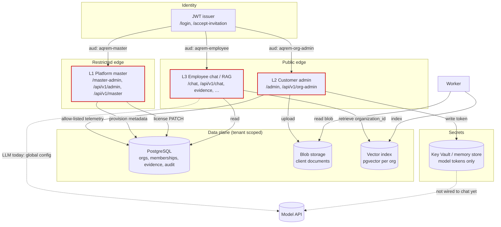

# AQREM three-layer architecture (trust boundaries)

**Crosses trust boundary (allowed):** license metadata, seat counts, health/version, credential expiry date (no secret), setup flags.

**Must not cross:** document text, questions, answers, raw tokens, embeddings content to L1.
